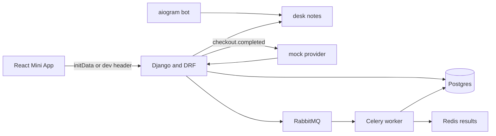

# BookNook Telegram desk

**This is a demo / portfolio project.** BookNook is a fictional reading room. The bot, the mini app, and the subscription provider are not connected to a real shop or a real payment processor. `docker compose up` runs without a Telegram token: the bot stays idle and the mini app uses a dev member header.

Members open a Telegram Mini App to see a plan, pay through a mock desk, and ask a short FAQ. A bot command answers the same notes. A Celery job writes the receipt after payment.

## Problem

A tiny membership desk needs three things that are awkward to demo together:

- proof that a Mini App user really came from Telegram
- a payment flow that does not require a merchant account
- a background job for the receipt, plus a bot that answers the same questions as the app

## Architecture



## Features

- Django REST API for the member, the plan, checkout, confirm, and the provider webhook
- Telegram `initData` check: HMAC-SHA256 with the `WebAppData` key, sorted fields, and a max age
- Dev header `X-Dev-User` so the UI runs outside Telegram. Turn it off with `ALLOW_DEV_AUTH=0`
- Mock subscription: pending checkout, then `checkout.completed`
- Celery receipt task on RabbitMQ, with Redis as the result backend
- FAQ ranking over `sample_data/faq.json`, answered by a swappable mock model
- aiogram `/start` and `/faq`. With an empty token the process only serves a health check
- React Mini App: member line, plan card, mock pay button, FAQ box

## Tech stack

- Python 3.12, Django, Django REST framework, Celery
- PostgreSQL, RabbitMQ, Redis
- aiogram
- React and Vite
- Ruff, pytest, ESLint, Prettier, Vitest
- Docker Compose and GitHub Actions

## Quickstart

```bash
cp .env.example .env
docker compose up --build
```

- Mini App: http://localhost:5173
- API: http://localhost:8020/api/health
- Bot health: http://localhost:8081

Compose uses local demo credentials (`booknook` / `booknook-mock`). They are not production secrets. Set `TELEGRAM_BOT_TOKEN` in `.env` when you want the bot to poll Telegram. Set `ALLOW_DEV_AUTH=0` when you only want real `initData`.

The API is published on host port **8020** so it can sit beside the other BookNook demos. Postgres is on host port **5433**.

Without Docker, the API falls back to SQLite and runs Celery tasks in-process:

```bash
pip install -r backend/requirements.txt
cd backend && python manage.py migrate && python manage.py runserver 8020
```

## API examples

Dev member, no Telegram:

```bash
curl http://localhost:8020/api/me -H "X-Dev-User: 1001"

curl -X POST http://localhost:8020/api/subscriptions/checkout \
  -H "Content-Type: application/json" \
  -H "X-Dev-User: 1001" \
  -d "{\"plan_id\": \"reading-room\"}"
```

Take `checkout_id` from that response. It looks like `chk_1001_reading-room_ab12cd34`.

```bash
curl -X POST http://localhost:8020/api/subscriptions/confirm \
  -H "Content-Type: application/json" \
  -H "X-Dev-User: 1001" \
  -d "{\"checkout_id\": \"chk_1001_reading-room_ab12cd34\"}"
```

The same transition from a provider webhook:

```bash
curl -X POST http://localhost:8020/api/subscriptions/webhook \
  -H "Content-Type: application/json" \
  -H "X-Mock-Signature: booknook-mock" \
  -d "{\"type\": \"checkout.completed\", \"checkout_id\": \"chk_1001_reading-room_ab12cd34\"}"
```

FAQ:

```bash
curl -X POST http://localhost:8020/api/faq \
  -H "Content-Type: application/json" \
  -H "X-Dev-User: 1001" \
  -d "{\"question\": \"What is the late fee?\"}"
```

Inside Telegram the Mini App sends `Authorization: TMA <initData>` instead of `X-Dev-User`. The server rebuilds the data-check string, signs it with HMAC-SHA256(`WebAppData`, bot token), and compares the hash.

## Design decisions

- **Core rules live outside Django.** Init-data validation, plan transitions, and FAQ ranking are plain functions in `src/booknook_core`. The Django views and the bot both call them, and most tests do not boot the ORM.
- **The mock provider is explicit.** `confirm` is the button in the Mini App, because there is no hosted checkout page. `webhook` is the path a real provider would call, and it requires `X-Mock-Signature`. A real integration would replace those two entry points and keep `apply_provider_event` as the state change.
- **Receipts are a Celery task.** Tests set `CELERY_TASK_ALWAYS_EAGER` so the receipt exists before the HTTP response returns. Compose sets it to `0` and runs a worker against RabbitMQ. RabbitMQ's default `guest` user cannot connect across containers, so the broker user is `booknook`.
- **The bot idles without a token.** `docker compose up` should stay up on a laptop with no bot. The health port still answers. Polling starts only when `TELEGRAM_BOT_TOKEN` is set.
- **FAQ answers quote a note.** `MockFaqModel` returns the best matching desk entry. That is weaker than a hosted model and strong enough to show ranking, sources, and the bot command. The `FaqModel` protocol is the swap point.
- **CORS is open in this demo.** The Mini App on port 5173 calls the API on port 8020, and a Telegram webview would be another origin. Lock the origin list before any real deployment.

## Roadmap

- Verify the bot token's secret only in a dedicated auth service
- Replace the mock provider with a hosted checkout and signed webhooks
- Store FAQ answers that the member rated as wrong
- Add a second plan without changing the checkout state machine

## Tests

```bash
cd backend && pytest
cd frontend && npm test
```

GitHub Actions runs Ruff, pytest, ESLint, Prettier, and Vitest. The suite uses SQLite and eager Celery tasks, so CI does not start RabbitMQ.

## Related projects

- [BookNook shelf assistant](https://github.com/MiladGhorbaniG/rag-docs-assistant) — retrieval chat over shelving notes, with citations
- [BookNook editorial desk](https://github.com/MiladGhorbaniG/multi-agent-workflow) — planner, researcher, writer, and reviewer
- [Introduction to carried out projects](https://github.com/MiladGhorbaniG/Introduction-to-carried-out-projects) — earlier work, plus the other public repositories
